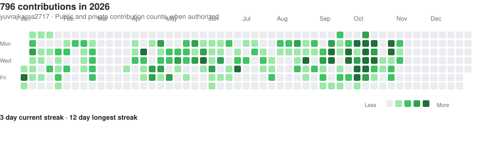

# Contribution heatmap setup

`scripts/generate-heatmap.js` reads your contribution calendar through GitHub's GraphQL API (`contributionsCollection` → `contributionCalendar`) and writes a static SVG to `assets/contribution-heatmap.svg`. The workflow `.github/workflows/contribution-heatmap.yml` regenerates and commits it daily.

## 1. Create a token

Create a **classic personal access token** with only the `read:user` scope. That scope lets the contribution calendar include private and internal repository contributions.

- GitHub Settings → Developer settings → Personal access tokens → Tokens (classic).
- Add it to this repository as an Actions secret named `CONTRIBUTION_TOKEN`
  (Settings → Secrets and variables → Actions → New repository secret).

The workflow only uses `CONTRIBUTION_TOKEN` to read the calendar. It commits with the built-in Actions token.

Also turn on **Include private contributions on my profile** in your profile settings. GitHub returns only aggregate counts for private work, not repository names or code.

## 2. Run the workflow once

Actions tab → **Update contribution heatmap** → **Run workflow**. After that it runs daily at 06:17 UTC (scheduled runs can be delayed under load).

## 3. Add the image to README.md

Place this outside the `<!-- GITHUB_STATS_START -->` / `<!-- GITHUB_STATS_END -->` markers, because `scripts/update_readme.py` rewrites everything between them:

```markdown
<div align="center">
  
</div>
```

## Year

The year defaults to the current UTC year. To render a different one, set `CONTRIBUTION_YEAR` (for example `"2025"`) in the workflow's "Generate SVG" step env.

## Local run (Node.js 20+)

```powershell
$env:GITHUB_TOKEN = "your_read_user_token"
npm run generate
```

## Limitations

- The calendar returns combined daily counts, with no public/private split.
- Streaks are computed within the selected year using UTC dates, so they can differ from GitHub's own display near timezone boundaries.
- `<title>` hover tooltips don't work when GitHub renders the SVG through ``.
- Empty cells use the light-theme gray in dark mode too.
